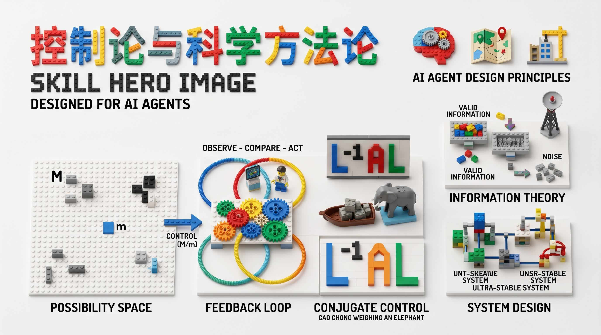

# CONTROL.SKILLS - Control Theory for AI Agent Design

<p align="center">
    
</p>

<p align="center">
    <strong>Cybernetics, Systems Theory, and Information Theory -- Mapped to AI Agent Design</strong><br/>
    One core skill distilling the foundational principles of control theory into actionable Agent design guidance.
</p>

An Agent Skills knowledge base that maps control theory, systems theory, and information theory into practical AI Agent design methodology -- covering possibility space, feedback loops, conjugate control (tool use), stability, self-organization, experiment design, and intelligence amplification. Based on the core ideas from Jin Guantao and Hua Guofan's "Cybernetics and Scientific Methodology" (《控制论与科学方法论》).

The objective is straightforward: distill the timeless principles of cybernetics into a set of installable, searchable, and composable skills that help AI Agents reason more robustly about planning, execution, error correction, and system design.

## Knowledge Source

This repository is a distillation layer, not a textbook mirror.

| Source | What It Provides | How We Use It |
|---|---|---|
| 金观涛、华国凡《控制论与科学方法论》 | Foundational cybernetics principles, systems theory, information theory, stability analysis, self-organization | Distilled into Agent-applicable design patterns: feedback loops, control capacity estimation, experiment templates, failure detection mechanisms |
| Classical control theory literature | Negative/positive feedback, transfer functions, stability criteria | Distilled into Agent feedback loop design templates and runaway detection patterns |
| Information theory (Shannon, etc.) | Channel capacity, noise filtering, signal fidelity | Distilled into Agent information processing guidelines: filtering, cross-validation, channel matching |

Processing principles:

- Prioritize actionable Agent design patterns over abstract theory.
- Use vivid analogies from the original text (Cao Chong weighing the elephant, hawk catching rabbit, Madame Curie purifying radium) to make principles memorable and greppable.
- Map every cybernetics concept to a concrete Agent design concern.

## Quick Start

The preferred entry point is `control-theory`:

```bash
npx skills add professoxrmoriarty/control-theory-skill
```

If your tooling supports pulling a single SKILL.md directly, you can also use:

- frontmatter name: `control-theory`
- raw URL: `https://raw.githubusercontent.com/professoxrmoriarty/control-theory-skill/main/skills/control-theory/SKILL.md`

## Skill Content Overview

| Chapter | Topic | Key Agent Design Insight |
|---|---|---|
| 0 | Core Axiom | Control = directed selection in possibility space |
| 1 | Possibility Space & Control Capacity | Estimate M/m before acting; capacity compounds across steps |
| 2 | Four Control Methods | Random, elimination, conjugate (tool use), negative feedback |
| 3 | Positive Feedback & Runaway | Detect diverging error; circuit-breaker patterns |
| 4 | Information Theory | Channel capacity matching; five filtering methods; first-hand sources |
| 5 | System Design | Boundary definition; steady states; ultra-stable systems; self-organization |
| 6 | Qualitative vs Gradual Change | Stability-based change assessment; hysteresis awareness |
| 7 | Black Box Epistemology | Experiment design; five obstacles to truth; falsifiability |
| 8 | Feedback Loop Templates | Basic loop, multi-layer (ultra-stable), experiment system |
| 9 | Intelligence Amplification | Task decomposition; organizational core selection |
| 10 | Design Checklist | 12-point Agent system review checklist |

## Main Entry Point

| Type | Skill | Purpose | When to Use |
|---|---|---|---|
| Core Entry | [control-theory](./skills/control-theory/SKILL.md) | Agent design methodology based on cybernetics | Designing Agent systems, debugging feedback loops, planning task decomposition, reviewing system architecture |

## Reference Material

The [`reference/`](./reference/) directory contains the original full text of"Cybernetics and Scientific Methodology"(《控制论与科学方法论》) by Jin Guantao and Hua Guofan. When using the skill, you can open this file at any time to check the original context behind any concept or principle.

## Installation

### General Installation

```bash
npx skills add professoxrmoriarty/control-theory-skill
```

### Raw URL Installation

```bash
curl -fsSL https://raw.githubusercontent.com/professoxrmoriarty/control-theory-skill/main/skills/control-theory/SKILL.md
```

### Local Use as a Knowledge Base

```bash
git clone https://github.com/professoxrmoriarty/control-theory-skill.git
cd control-theory-skill
```

## Design Principles

- Actionable design patterns take priority over abstract theory.
- Every principle maps to a concrete Agent design concern.
- Content auditability and traceability to source material.
- Vivid analogies preserved from the original text for memorability.
- Terminology table provided for cross-domain translation.

## Contributing

PRs are welcome. Key areas include:

- Additional control theory principles applicable to Agent design
- Real-world Agent failure cases mapped to control theory explanations
- Improved feedback loop templates and design patterns
- Cross-references to other Agent design methodologies
- Terminology consistency and content clarity

Contributions should be traceable to established control theory or systems theory sources.
